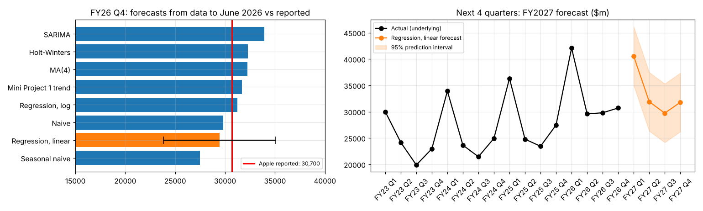
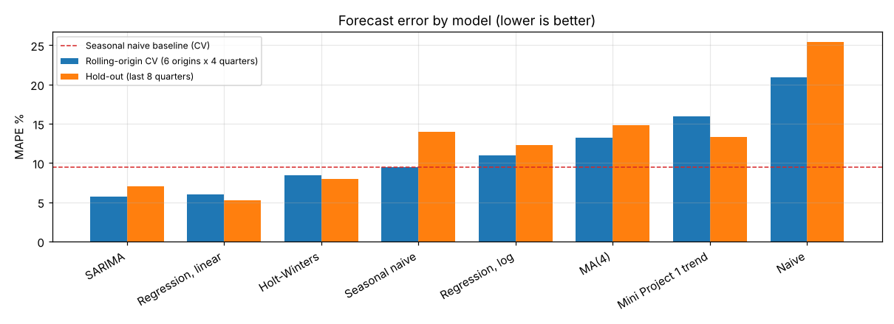
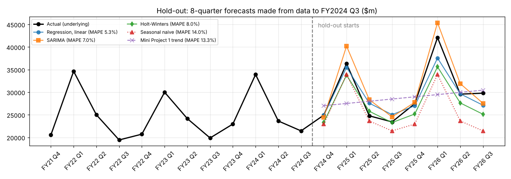

# Forecasting Apple's Quarterly Net Income: 8 Models, Two Validation Schemes and a Check Against the Reported Result (Python)

**Result:** using data only up to **June 2026 (FY2026 Q3)**, the selected model forecast FY2026 Q4 net income at
**$29.4bn**. Apple reported **$30.7bn** on 30 Oct 2026, so the error is **−4.1%**, and the actual falls inside the
model's 95% prediction interval ($23.8bn – $35.1bn). The implied full-year FY2026 forecast was **$130.9bn** against
**$132.2bn** reported (**−1.0%**). In validation, the selected model's average MAPE was **52% lower** than the
seasonal-naive baseline.



## Business question
How accurately can a transparent statistical model forecast next quarter's net income for a large, highly seasonal
business, and does it beat the simple rules of thumb analysts already use?

## How this extends my Mini Project 1
Mini Project 1 (MSc Programming & Data Analytics workshop) regressed Apple's **annual revenue on `Year`** with
`statsmodels` OLS and judged the fit on in-sample R². This project keeps the same tools and closes three gaps:

| Gap in Mini Project 1 | What this project does |
|---|---|
| Annual data, no seasonality | 43 **quarterly** observations; the holiday quarter is ~34% of annual profit |
| One model, judged on in-sample R² | **8 models**, scored out-of-sample with a **hold-out** and **rolling-origin cross-validation** |
| Never checked against reality | FY2026 Q4 forecast saved **before** the actual figure is introduced, then compared with Apple's reported result |

## Workflow
**1. Data cleaning.** Parsed a messy hand-built Excel file: mixed quarter labels (including the typo "Fouth"), numbers
stored as text with commas and tabs, quarters out of order, blank-row year blocks and a misplaced year label.

**2. Data checks**

| Check | Result |
|---|---|
| Duplicate quarters | 0 |
| Missing quarters | 0 |
| Quarter-on-quarter move > 50% | 7 flagged, **all fiscal Q1 holiday quarters** (seasonal false positives) |
| 4 quarters = reported annual total | 10/10 years match |
| Quarter-by-quarter cross-check with Apple filings | **2 keying errors found** in FY2021 (Q1 28,775 → 28,755; Q4 20,531 → 20,551) |

The two FY2021 errors offset each other, so the annual sum still matched, and each was only 0.1%. None of the
automated checks caught them; only reconciling against the source documents did.
FY2024 Q4 was also normalised for a one-time **$10.2bn EU State Aid tax charge**.

**3. Models** (`statsmodels`). All settings are chosen on training data only.

| Model | Specification |
|---|---|
| Naive | last quarter repeated |
| **Seasonal naive (main baseline)** | same quarter last year |
| MA(4) | mean of the last 4 quarters |
| Mini Project 1 trend | `NI ~ t` |
| Regression, log | `log(NI) ~ t + C(Q)` |
| Regression, linear | `NI ~ t + C(Q)` |
| Holt-Winters | additive trend; additive/multiplicative season and damping chosen by AIC |
| SARIMA | `log(NI)`, (p,d,q)(P,1,Q)₄ grid, order chosen by AIC |

**4. Validation**
* **Hold-out:** train FY2016 Q1 – FY2024 Q3, then forecast the last 8 quarters in one go.
* **Rolling-origin CV:** 6 origins, each forecasting 4 quarters ahead (24 forecasts per model), with every model refitted at each origin.
* **Metrics:** MAE, RMSE, MAPE, and % improvement over seasonal naive.
* **Selection rule:** lowest average MAPE across the two schemes.

## Results
| Model | Hold-out MAPE | Rolling-CV MAPE | Average | vs seasonal naive |
|---|---|---|---|---|
| **Regression, linear (selected)** | **5.3%** | 6.0% | **5.6%** | **−52%** |
| SARIMA | 7.0% | **5.7%** | 6.4% | −46% |
| Holt-Winters | 8.0% | 8.4% | 8.2% | −30% |
| Regression, log | 12.3% | 11.0% | 11.7% | −1% |
| Seasonal naive (baseline) | 14.0% | 9.5% | 11.7% | – |
| MA(4) | 14.8% | 13.2% | 14.0% | +20% |
| Mini Project 1 trend | 13.3% | 15.9% | 14.6% | +25% |
| Naive | 25.4% | 20.9% | 23.2% | +98% |

MAE and RMSE for every model are in `results/holdout_scores.csv` and `results/rolling_cv_scores.csv`.




* Only the models that capture seasonality clearly beat the baseline. The Mini Project 1 trend line is worse than
  simply repeating last year's quarter.
* SARIMA edges out the regression in rolling CV (5.7% vs 6.0%), but drifts over the longer 8-quarter hold-out. The
  regression wins on the combined rule and is simpler to explain.
* **Diagnostics (selected model):** R² 0.915; trend and quarter effects significant with Newey-West (HAC) errors;
  residuals normal (Jarque-Bera p = 0.93) and homoscedastic (Breusch-Pagan p = 0.45), but autocorrelated
  (Durbin-Watson 0.82), so prediction intervals are approximate.

## Reality check and FY2027 forecast
| | Forecast | Apple reported | Error |
|---|---|---|---|
| FY2026 Q4 | 29,431 | 30,700 | −4.1% (inside 95% PI) |
| FY2026 full year | 130,895 | 132,200 | −1.0% |

Forecast for the next 4 quarters (FY2027, US$ m): Q1 40,560 · Q2 31,899 · Q3 29,726 · Q4 31,769 → **total 133,953 (+1.3% vs FY2026)**.

## Honest caveats
* On the single FY2026 Q4 quarter, some models landed closer than the selected one (e.g. log regression +1.7%,
  Mini Project 1 trend +3.1%; see `results/fy26_q4_all_models.csv`). One quarter is one draw. The model was chosen
  on 8 + 24 out-of-sample forecasts, before this result was looked at.
* The ">50% quarter-on-quarter" rule is a poor error detector for a seasonal business: it produced 7 false positives
  and missed the real errors.
* The sample is small (43 quarters), and a trend model cannot anticipate shocks. FY2027 Q1 is forecast below the
  record FY2026 Q1, so that quarter is the most uncertain.
* Apple reports net income to one decimal place in $bn, so the actual is taken as 30,700 ± 50.

## Verification sources
* FY2026 Q4 ($30.7bn) and FY2026 ($132.2bn) net income: [MacRumors, 2 Nov 2026](https://macrumors.com/2026/11/02/apple-4q-2026-earnings), [iClarified](https://www.iclarified.com/103239/apple-reports-record-q4-revenue-of-1145-billion-307-billion-profit), [Apple Form 8-K Ex. 99.1](https://www.sec.gov/Archives/edgar/data/0000320193/000032019326000024/a8-kex991q4202609262026.htm)
* FY2021 Q1 net income $28,755m: [Apple press release, Business Wire, 27 Jan 2021](https://www.businesswire.com/news/home/20210127005934/en)
* FY2021 Q4 net income $20.55bn: [finanzen.at, 28 Oct 2021](https://script.finanzen.at/nachrichten/aktien/apple-inc-q4-earnings-increase-in-line-with-estimate-1030912134)
* FY2024 Q4 one-time $10.2bn EU tax charge: [MacRumors, 31 Oct 2024](https://www.macrumors.com/2024/10/31/apple-4q-2024-earnings/)

## Repository
```
AAPL_Quarterly_Net_Income_Forecasting.ipynb   full analysis, executed with outputs
data/        raw Excel (as received) + cleaned, validated CSV
results/     hold-out and rolling-CV forecasts and scores, model selection, FY26 Q4 check, FY27 forecast, summary.txt
figures/     5 charts
```

## Reproduce
```bash
pip install -r requirements.txt
jupyter nbconvert --to notebook --execute AAPL_Quarterly_Net_Income_Forecasting.ipynb
```
